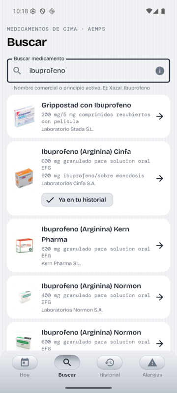
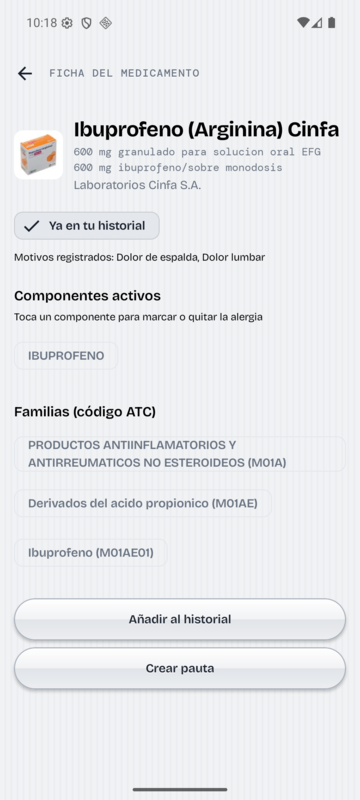
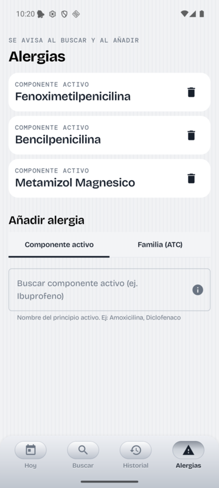
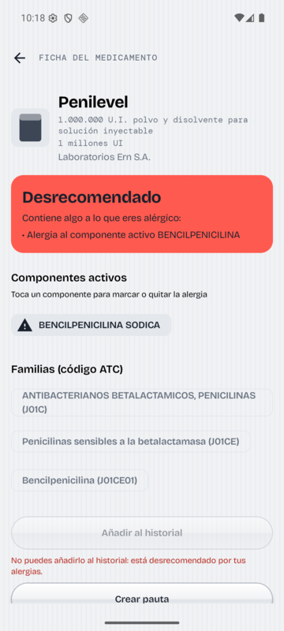
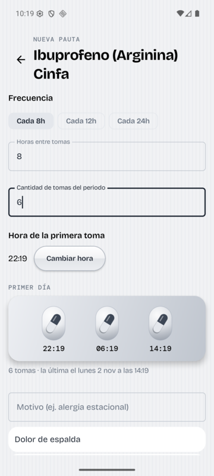
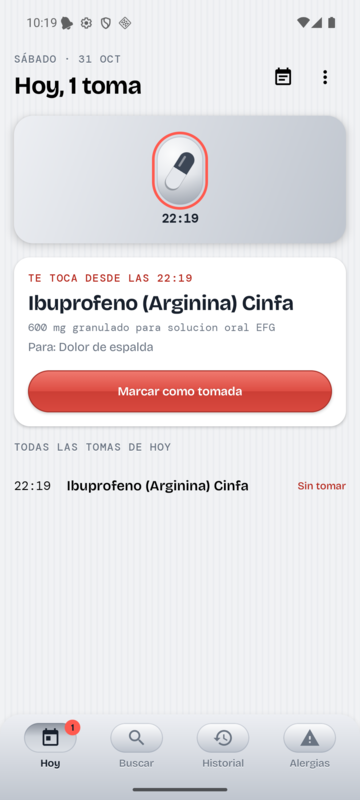
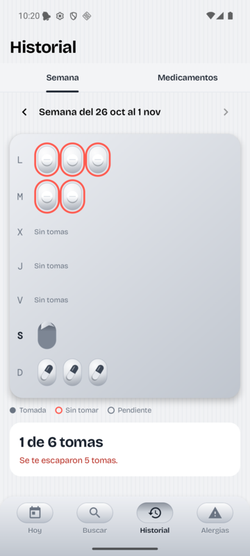
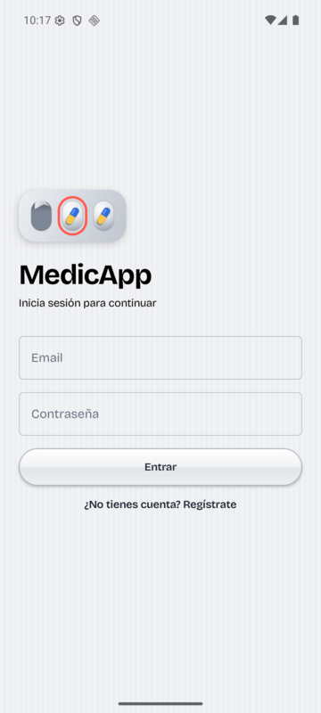

# MedicApp

MedicApp is a small Android app that helps you keep track of the medicines you take.
Think of it as a digital pill box: you look up a medicine, tell the app how often you need
to take it, and it reminds you when it's time and keeps a record of what you've taken.

It also knows what you're allergic to, and warns you before you add a medicine that
contains something you shouldn't take.

> The app's interface is in Spanish, and the medicine catalogue comes from Spain's official
> drug registry (CIMA, run by the Spanish Agency of Medicines, AEMPS).

## What you can do with it

### Look up any medicine

Type a brand name or an active ingredient (for example *ibuprofeno*) and the app lists the
matching medicines, with a photo of the box, the dose and the manufacturer. Medicines you
already have in your history are tagged so you can spot them at a glance.

If something isn't in the official catalogue, you can still add it by hand.

### See what's inside

Each medicine has its own page showing its active ingredients and the drug family it
belongs to. From there you can add it to your history or set up a schedule for taking it.

### Get warned about allergies

Keep a list of the ingredients (or whole drug families) you're allergic to. Whenever a
medicine contains one of them, the app shows a big red warning and won't let you add it.

  
  &nbsp;
  

### Plan your doses

Tell the app how often you take a medicine (every 8, 12 or 24 hours, or any interval you
like), how many doses in total and when the first one is. It shows you a preview of the
doses as pills in a blister pack before you save.

### Never miss a dose

The **Hoy** (Today) screen shows today's doses as a blister pack. When it's time, you get a
notification; once you take the pill, tap **Marcar como tomada** (mark as taken) and that blister pops open.

### Look back at your week

The **Historial** (History) screen shows each day of the week as a row of blisters: popped ones were
taken, red-ringed ones were missed. A summary at the bottom tells you how many doses you
took out of the total.

## Your account

You sign in with an email and password. Your medicines, schedules and allergies are saved
to your account in the cloud, so they're still there if you reinstall the app or switch
phones.

## Good to know

- MedicApp is a personal project and isn't published on Google Play.
- It's a reminder and record-keeping tool, not medical advice. Always follow what your
  doctor or pharmacist tells you.
